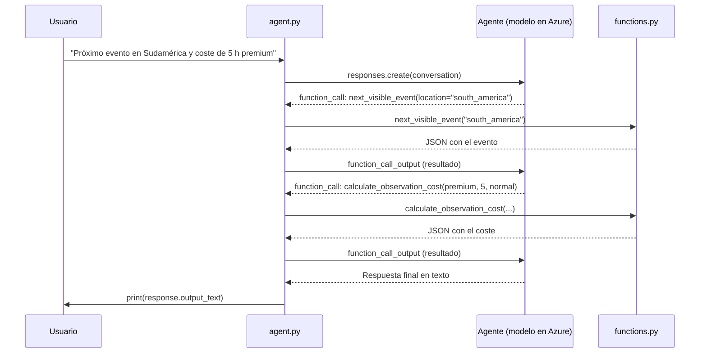

# Ejercicio: Agente con herramientas personalizadas (Function Calling) en Azure AI Foundry

En este ejercicio vas a crear un **agente de astronomía** que puede llamar a funciones escritas en Python. El agente es capaz de:

- Buscar el **próximo evento astronómico visible** desde un continente.
- Calcular el **coste de alquilar un telescopio** según su categoría, las horas y la prioridad.
- Generar un **informe de la observación** y guardarlo en un fichero.

Lo más importante que aprenderás: **el modelo decide qué función llamar y con qué argumentos, pero tu código es quien la ejecuta**.

---

## Índice

1. [Requisitos previos](#1-requisitos-previos)
2. [Cómo cargar el proyecto](#2-cómo-cargar-el-proyecto)
3. [Cómo cargar los requisitos](#3-cómo-cargar-los-requisitos)
4. [Iniciar sesión en Azure](#4-iniciar-sesión-en-azure)
5. [El fichero `.env`](#5-el-fichero-env)
6. [El fichero `functions.py`](#6-el-fichero-functionspy)
7. [El fichero `agent.py`](#7-el-fichero-agentpy)
8. [Cómo decide el agente qué función llamar](#8-cómo-decide-el-agente-qué-función-llamar)
9. [Ejecutar y probar](#9-ejecutar-y-probar)
10. [Problemas frecuentes](#10-problemas-frecuentes)
11. [Ampliaciones propuestas](#11-ampliaciones-propuestas)

---

## 1. Requisitos previos

- **Visual Studio Code** con la extensión **Python** instalada.
- **Python 3.12 o 3.13** (recomendado). Con versiones muy recientes, algunos paquetes pueden no tener aún binarios compatibles.
- **Azure CLI** (`az`) instalado.
- Un **proyecto de Azure AI Foundry** con un modelo desplegado (por ejemplo `gpt-5.2`).
- Tu usuario debe tener un rol con permisos sobre el proyecto, por ejemplo **Azure AI User**.

---

## 2. Cómo cargar el proyecto

1. Clona el repositorio oficial de Microsoft Learn (o descarga el ZIP desde GitHub y descomprímelo):

   ```powershell
   git clone https://github.com/MicrosoftLearning/mslearn-ai-agents.git
   ```

2. Abre la carpeta del ejercicio en VS Code. El ejercicio está en `Labfiles/02-agent-custom-tools/Python` dentro del repositorio clonado:

   ```powershell
   cd mslearn-ai-agents\Labfiles\02-agent-custom-tools\Python
   code .
   ```

   > Es importante abrir **la carpeta del ejercicio** y no una carpeta superior. El código lee los ficheros `data/...` con rutas relativas y las busca desde donde ejecutas el script.

3. Comprueba que ves esta estructura:

   ```text
   Python/
   ├── agent.py
   ├── functions.py
   ├── requirements.txt
   ├── .env
   └── data/
       ├── events.txt
       ├── telescope_rates.txt
       └── priority_multipliers.txt
   ```

---

## 3. Cómo cargar los requisitos

### 3.1. Crear y activar un entorno virtual

Un entorno virtual aísla las librerías de este ejercicio del resto de tu equipo. En el terminal de VS Code (`Ctrl+ñ`):

```powershell
python -m venv .venv
.venv\Scripts\Activate.ps1
```

El prompt debería empezar por `(.venv)`.

> Si PowerShell bloquea la activación, ejecuta antes:
> `Set-ExecutionPolicy -Scope Process -ExecutionPolicy Bypass`

### 3.2. Seleccionar el intérprete en VS Code

`Ctrl+Shift+P` → **Python: Select Interpreter** → elige el que indica `.venv`.

Así el botón de ejecutar, el terminal y el análisis de código (Pylance) usan el mismo Python y las mismas librerías.

### 3.3. Instalar las dependencias

```powershell
pip install -r requirements.txt
```

### 3.4. Qué contiene `requirements.txt`

| Paquete | Para qué sirve |
|---|---|
| `python-dotenv` | Lee el fichero `.env` y carga sus valores como variables de entorno. (Se instala como `python-dotenv` pero se importa como `dotenv`.) |
| `azure-identity` | Proporciona `DefaultAzureCredential`, que obtiene tu identidad de Azure sin usar claves en el código. |
| `azure-ai-projects==2.3.0` | SDK de Azure AI Foundry: crea el cliente del proyecto, los agentes y sus versiones. |
| `openai<3` | Cliente de OpenAI usado para las conversaciones y las respuestas. Está limitado a versiones menores de la 3 porque la 3.x cambia una dependencia interna (`httpx` por `httpx2`) y rompe `azure-ai-projects`. |

---

## 4. Iniciar sesión en Azure

El programa **no usa ninguna clave de API**. Se autentica con tu identidad de Azure mediante `DefaultAzureCredential`, que reutiliza la sesión que dejas abierta con Azure CLI:

```powershell
az login
```

Si aparece una ventana de selección (personal / organización) que no responde, usa el flujo por código de dispositivo:

```powershell
az login --use-device-code
```

Te mostrará una URL (https://microsoft.com/devicelogin) y un código. Ábrela en el navegador, pega el código e inicia sesión.

Para elegir un tenant concreto:

```powershell
az login --tenant <tu-tenant-id> --use-device-code
```

Comprueba que la sesión está activa:

```powershell
az account show
```

> **Ventajas de este enfoque:** no hay secretos en el código ni en el repositorio, los tokens caducan y se renuevan solos, y los permisos se controlan con roles (RBAC).

---

## 5. El fichero `.env`

Guarda la **configuración** del programa fuera del código, de modo que puedas cambiar de proyecto o de modelo sin tocar `agent.py`.

```env
PROJECT_ENDPOINT="https://<tu-recurso>.services.ai.azure.com/api/projects/<tu-proyecto>"
MODEL_DEPLOYMENT_NAME="gpt-5.2"
```

| Variable | Qué es | Dónde la encuentras |
|---|---|---|
| `PROJECT_ENDPOINT` | La URL del **proyecto** de Azure AI Foundry al que se conecta el cliente. | Portal de Foundry → tu proyecto → página de **Overview** → *Endpoint del proyecto*. |
| `MODEL_DEPLOYMENT_NAME` | El **nombre del despliegue** del modelo (no el nombre genérico del modelo). | Portal de Foundry → **Models + endpoints** → columna *Name*. |

En `agent.py` se leen así:

```python
load_dotenv()
project_endpoint = os.getenv("PROJECT_ENDPOINT")
model_deployment = os.getenv("MODEL_DEPLOYMENT_NAME")
```

**Buenas prácticas**

- Cada alumno debe poner **sus propios valores**.
- Añade `.env` a tu `.gitignore` para no subirlo al repositorio.
- Publica en su lugar un fichero `.env.example` con valores de ejemplo.
- Si el nombre del despliegue no coincide, obtendrás un error de "deployment not found".

---

## 6. El fichero `functions.py`

Contiene la **lógica de negocio**: las funciones Python que el agente podrá usar. Aquí no hay nada de IA: son funciones normales que reciben parámetros y devuelven un resultado.

### 6.1. Carga de datos

Al importar el módulo se cargan tres ficheros de la carpeta `data/`:

```python
EVENTS = _load_events()
TELESCOPE_RATES = _load_rates("data/telescope_rates.txt")
PRIORITY_MULTIPLIERS = _load_rates("data/priority_multipliers.txt")
```

| Fichero | Formato por línea | Ejemplo |
|---|---|---|
| `data/events.txt` | `nombre\|tipo\|MM-DD\|ubicación1;ubicación2` | `Geminids Meteor Shower\|meteor_shower\|12-14\|north_america;south_america;europe;asia;africa;australia` |
| `data/telescope_rates.txt` | `categoría\|precio por hora` | `premium\|300.00` |
| `data/priority_multipliers.txt` | `prioridad\|multiplicador` | `normal\|1.25` |

Valores disponibles en los ficheros del repositorio:

- **Categorías de telescopio:** `standard` (50), `advanced` (120), `premium` (300) por hora.
- **Prioridades:** `low` (1.00), `normal` (1.25), `high` (1.75), `urgent` (2.50).
- **Eventos:** nueve eventos a lo largo del año (Quadrantids, Annular Solar Eclipse, Total Lunar Eclipse, Lyrids, Jupiter-Venus Conjunction, Saturn-Mars Conjunction, Partial Solar Eclipse, Perseids y Geminids).
- **Ubicaciones:** `north_america`, `south_america`, `europe`, `asia`, `africa`, `australia` y `antarctica`.

`_load_events` convierte cada fecha en un número `MMDD` (por ejemplo, el 12 de diciembre pasa a ser `1212`) para poder **ordenar y comparar** fechas fácilmente, y guarda las ubicaciones como un `set`.

### 6.2. Las tres funciones

#### `next_visible_event(location)`

Devuelve el **próximo evento visible** desde una ubicación.

- Normaliza el texto (`"South America"` → `south_america`).
- Recorre los eventos ordenados por fecha y devuelve el primero cuya fecha sea hoy o posterior y que sea visible desde esa ubicación.
- Si no hay ninguno, devuelve un mensaje `No upcoming events found...`.

#### `calculate_observation_cost(telescope_tier, hours, priority)`

Calcula el coste de la observación:

```text
coste base = tarifa por hora de la categoría × horas
coste total = coste base × multiplicador de prioridad
```

Valida que la categoría y la prioridad existan y que las horas sean mayores que cero; si no, devuelve un JSON con un campo `error`.

#### `generate_observation_report(event_name, location, telescope_tier, hours, priority, observer_name)`

Genera un **informe de texto** y lo guarda en un fichero `report_<evento>_<fecha>.txt` en la carpeta desde la que ejecutas el programa. Internamente reutiliza las dos funciones anteriores y devuelve un JSON con el nombre del fichero creado.

### 6.3. Regla de oro: devolver siempre `str` (JSON)

Las tres funciones devuelven `json.dumps(...)`, es decir, **texto**. Esto es obligatorio porque el campo `output` que enviamos de vuelta al agente espera una cadena de texto. Devolver también los errores como JSON permite que el modelo los lea y se los explique al usuario.

---

## 7. El fichero `agent.py`

Es el **programa principal**: define las herramientas, crea el agente en Azure AI Foundry y mantiene la conversación con el usuario.

### 7.1. Imports

```python
from azure.ai.projects import AIProjectClient
from azure.identity import DefaultAzureCredential
from azure.ai.projects.models import PromptAgentDefinition, FunctionTool
from openai.types.responses.response_input_param import FunctionCallOutput, ResponseInputParam
from functions import next_visible_event, calculate_observation_cost, generate_observation_report
```

| Elemento | Función |
|---|---|
| `AIProjectClient` | Cliente para conectarse a tu proyecto de Foundry y gestionar agentes. |
| `DefaultAzureCredential` | Tu identidad de Azure (la de `az login`). |
| `PromptAgentDefinition` | Define cómo es el agente: modelo, instrucciones y herramientas. |
| `FunctionTool` | Describe **al modelo** una función que puede llamar. |
| `FunctionCallOutput` | Estructura para devolver al agente el **resultado** de una función. |
| `ResponseInputParam` | Tipo de dato para la lista de entradas que se envían al agente. |
| `functions` | Tus funciones Python reales. |

### 7.2. Conexión con el proyecto

```python
with (
    DefaultAzureCredential() as credential,
    AIProjectClient(endpoint=project_endpoint, credential=credential) as project_client,
    project_client.get_openai_client() as openai_client,
):
```

Abre tres recursos a la vez y los **cierra automáticamente** al terminar el bloque `with`:

- `credential`: tu identidad.
- `project_client`: para crear y borrar agentes.
- `openai_client`: para crear conversaciones y respuestas.

### 7.3. Definición de las herramientas (`FunctionTool`)

Cada herramienta es una **descripción** de una función, no la función en sí:

```python
event_tool = FunctionTool(
    name="next_visible_event",
    description="Get the next visible event in a given location.",
    parameters={
        "type": "object",
        "properties": {
            "location": {
                "type": "string",
                "description": "continent to find the next visible event in (e.g. 'north_america', ...)",
            },
        },
        "required": ["location"],
        "additionalProperties": False,
    },
    strict=True,
)
```

| Campo | Para qué sirve |
|---|---|
| `name` | Nombre que el modelo usará para llamar a la función. Debe coincidir con el que comprobamos después en el `if` / `elif`. |
| `description` | **Muy importante:** es lo que lee el modelo para decidir **cuándo** usar la herramienta. |
| `parameters` | Esquema JSON con los argumentos que debe generar el modelo. |
| `properties` | Cada parámetro con su tipo (`string`, `number`...) y su `description`, que guía al modelo sobre qué valor poner (por ejemplo, el formato `south_america`). |
| `required` | Parámetros obligatorios. El modelo no llamará a la función sin ellos. |
| `additionalProperties: False` | Prohíbe que el modelo invente argumentos que no existen. |
| `strict=True` | Obliga a que los argumentos cumplan **exactamente** el esquema. |

Hay tres herramientas: `event_tool`, `cost_tool` y `report_tool`.

### 7.4. Creación del agente

```python
agent = project_client.agents.create_version(
    agent_name="astronomy-agent",
    definition=PromptAgentDefinition(
        model=model_deployment,
        instructions="""You are an astronomy observations assistant ...""",
        tools=[event_tool, cost_tool, report_tool],
    ),
)
```

| Parámetro | Qué hace |
|---|---|
| `agent_name` | Nombre del agente en el proyecto. |
| `model` | Despliegue del modelo que actuará como "cerebro" (viene del `.env`). |
| `instructions` | Prompt de sistema: define el papel y el comportamiento del agente. |
| `tools` | Lista de herramientas disponibles. **Si una herramienta no está aquí, el agente no sabe que existe.** |

Cada vez que ejecutas `create_version`, se crea una **versión** del agente en tu proyecto.

### 7.5. La conversación

```python
conversation = openai_client.conversations.create()
```

Crea una conversación que **guarda el historial** en el servidor. Así el agente recuerda lo que se ha dicho antes, sin que tengamos que reenviar todos los mensajes cada vez.

### 7.6. El bucle de chat

```python
while True:
    user_input = input("...").strip()
    if user_input.lower() == "quit":
        break
    if not user_input:
        continue
```

Pide un texto al usuario. Con `quit` sale del bucle; si se deja vacío, vuelve a preguntar.

Después se envía el mensaje a la conversación y se pide una respuesta al agente:

```python
openai_client.conversations.items.create(
    conversation_id=conversation.id,
    items=[{"type": "message", "role": "user", "content": user_input}],
)

response = openai_client.responses.create(
    conversation=conversation.id,
    extra_body={"agent_reference": {"name": agent.name, "type": "agent_reference"}},
    input="",
)
```

- `conversation=conversation.id`: usa el historial de la conversación.
- `extra_body={"agent_reference": ...}`: indica **qué agente** debe responder. *(Antes la clave se llamaba `agent`; ahora está obsoleta y hay que usar `agent_reference`.)*
- `input=""`: el mensaje del usuario ya está en la conversación, así que no hace falta enviarlo de nuevo.

Si la respuesta tiene `status == "failed"`, se muestra el error y se pasa a la siguiente pregunta.

### 7.7. Limpieza

Al escribir `quit`, el programa borra el agente creado:

```python
project_client.agents.delete_version(agent_name=agent.name, agent_version=agent.version)
```

Esto evita acumular versiones de agentes en tu proyecto. Si cierras el programa con `Ctrl+C`, este paso no se ejecuta.

---

## 8. Cómo decide el agente qué función llamar

Esta es la parte clave del ejercicio. Hay que distinguir **quién hace qué**:

| Quién | Qué hace |
|---|---|
| **El modelo** (en Azure) | **Decide** si necesita una función, cuál, y con qué argumentos. **No ejecuta** nada. |
| **Tu código** (`agent.py`) | **Ejecuta** realmente la función Python y devuelve el resultado al modelo. |

> El modelo nunca ejecuta tu código. Solo te dice: *"necesito que llames a `next_visible_event` con `location='south_america'`"*.

### 8.1. En qué se basa el modelo para decidir

1. El **mensaje del usuario**.
2. Las **`instructions`** del agente.
3. El **`name`**, la **`description`** y el **esquema de parámetros** de cada `FunctionTool`.

Por eso las descripciones deben ser **claras y precisas**. Si la descripción es vaga, el modelo puede no llamar a la función o rellenar mal los argumentos.

### 8.2. El ciclo completo



### 8.3. Dónde ocurre en el código

#### Paso 1: detectar que el modelo pide una función

```python
for item in response.output:
    if item.type == "function_call":
```

La respuesta (`response.output`) es una **lista de elementos**. Si un elemento es de tipo `function_call`, el modelo no está respondiendo con texto: **está pidiendo que ejecutes una función**. Ese elemento contiene:

| Campo | Contenido |
|---|---|
| `item.name` | Nombre de la función que quiere llamar. |
| `item.arguments` | Argumentos en formato JSON (texto). |
| `item.call_id` | Identificador de la llamada, para emparejar la respuesta. |

#### Paso 2: ejecutar la función correspondiente

```python
args = json.loads(item.arguments)
if item.name == "next_visible_event":
    result = next_visible_event(**args)
elif item.name == "calculate_observation_cost":
    result = calculate_observation_cost(**args)
elif item.name == "generate_observation_report":
    result = generate_observation_report(**args)
else:
    result = json.dumps({"error": f"Unknown function {item.name}"})
```

- `json.loads` convierte el texto de los argumentos en un diccionario.
- `**args` expande ese diccionario como argumentos con nombre. Por eso los nombres del esquema deben coincidir **exactamente** con los parámetros de tu función Python.
- Este `if / elif` es el "enrutador": **tu código** relaciona el nombre que pide el modelo con la función real.

#### Paso 3: devolver el resultado al modelo

```python
input_list.append(
    FunctionCallOutput(
        type="function_call_output",
        call_id=item.call_id,
        output=result,
    )
)

response = openai_client.responses.create(
    input=input_list,
    previous_response_id=response.id,
    extra_body={"agent_reference": {"name": agent.name, "type": "agent_reference"}},
)
```

- `call_id` enlaza el resultado con la petición concreta del modelo.
- `previous_response_id` indica que es la **continuación** de la respuesta anterior.
- `output` debe ser un `str`.

#### Paso 4: repetir hasta tener una respuesta final

```python
while True:
    input_list = []
    for item in response.output:
        ...                      # ejecutar funciones pedidas
    if not input_list:           # no hay más funciones pedidas
        break
    response = openai_client.responses.create(...)   # devolver resultados
```

Este **bucle interno** es fundamental. Para la pregunta de ejemplo, el modelo necesita **dos** funciones **encadenadas**: primero busca el evento y luego calcula el coste. Si solo enviáramos los resultados una vez, la segunda respuesta podría ser otra petición de función en lugar de texto, y `response.output_text` saldría **vacío**.

La condición de salida es `if not input_list`: cuando una respuesta ya no contiene ninguna `function_call`, es la **respuesta final** y se muestra con:

```python
print(f"AGENT: {response.output_text}")
```

### 8.4. Resumen de la idea

```text
Usuario ─► Modelo: "¿Necesito una herramienta?"
                │
                ├─ Sí ─► devuelve function_call ─► TU CÓDIGO la ejecuta ─► devuelve el resultado al modelo ─┐
                │                                                                                          │
                └─ No ─► devuelve texto final ─► se muestra al usuario ◄───────────────────────────────────┘
```

---

## 9. Ejecutar y probar

Con el entorno virtual activo y la sesión de Azure iniciada:

```powershell
python agent.py
```

Prueba estas peticiones:

1. **Una sola función:**
   > What is the next event I can see from North America?

2. **Dos funciones encadenadas:**
   > Find me the next event I can see from South America and give me the cost for 5 hours of premium telescope time at normal priority.

3. **Tres funciones (con informe):**
   > Generate an observation report for the next event visible from South America, using a premium telescope for 5 hours at normal priority. The observer is `<tu nombre>`.

4. **Sin herramientas** (el modelo responde directamente):
   > What is a meteor shower?

5. **Un caso de error** (la categoría `ultra` no existe, así que la función devuelve un error que el modelo te explica):
   > How much does 3 hours of ultra telescope time cost?

6. **Un caso sin eventos** (`antarctica` solo tiene un eclipse en febrero, así que a partir de marzo no devuelve nada):
   > What is the next event I can see from Antarctica?

Escribe `quit` para salir y que se borre el agente.

---

## 10. Problemas frecuentes

| Síntoma | Causa probable | Solución |
|---|---|---|
| `ModuleNotFoundError: No module named 'dotenv'` | Las librerías no están instaladas en el Python que ejecuta el script. | Activa el `.venv`, ejecuta `pip install -r requirements.txt` y selecciona el intérprete correcto. |
| `DefaultAzureCredential failed to retrieve a token` | No has iniciado sesión en Azure. | Ejecuta `az login` (o `az login --use-device-code`). |
| El selector personal / organización no responde | Ventana emergente oculta del broker de Windows. | Usa `az login --use-device-code`. |
| `The 'agent' property is deprecated. Use 'agent_reference' instead.` | Sintaxis antigua en `extra_body`. | Cambia la clave `agent` por `agent_reference` en **las dos** llamadas a `responses.create`. |
| `AGENT:` sale vacío | Falta el bucle que encadena varias llamadas a funciones. | Usa el bucle interno `while True` descrito en la sección 8.3. |
| `FileNotFoundError: data/events.txt` | Ejecutas el script desde otra carpeta. | Abre la carpeta del ejercicio y ejecuta desde ahí. |
| Error de "deployment not found" | `MODEL_DEPLOYMENT_NAME` no coincide con el nombre del despliegue. | Revisa el nombre en el portal de Foundry. |
| Error 401 o 403 | Faltan permisos sobre el proyecto. | Pide el rol **Azure AI User** sobre el proyecto. |
| `No upcoming events found` | No quedan eventos este año para esa ubicación, o el nombre no existe en `events.txt`. | Revisa `data/events.txt` y mira la ampliación 1. |

**Para depurar**, añade justo antes del `print` final:

```python
print([(i.type, getattr(i, "name", None)) for i in response.output])
print(response.status, getattr(response, "error", None))
```

---

## 11. Ampliaciones propuestas

1. **Dar la vuelta al año.** Ahora `next_visible_event` solo busca eventos a partir de hoy hasta el 31 de diciembre. Si hoy es 15 de diciembre y el siguiente evento es en enero, no lo encuentra. Modifica la función para que, si no hay más eventos este año, devuelva el primero del año siguiente.
2. **Añadir una cuarta herramienta**, por ejemplo `list_events(location)`, que devuelva todos los eventos de un continente. Recuerda los tres pasos: escribir la función, definir su `FunctionTool` y añadirla al `if / elif` y a la lista `tools`.
3. **Mejorar las `instructions`:** por ejemplo, haz que el agente pida el nombre del observador antes de generar un informe en lugar de inventarlo.
4. **Cambiar una `description`** a algo vago (por ejemplo, `"Does stuff"`) y observa cómo cambia la decisión del modelo.
5. **Probar `strict=False`** y comprobar qué diferencia hay en los argumentos que genera el modelo.
