# Práctica 1 · Entrenar un modelo con ML automatizado en Azure Machine Learning

**Duración:** 30 minutos (el entrenamiento se ejecuta en segundo plano; en la prueba de referencia tardó unos 17 minutos)
**Nivel:** introductorio, sin código
**Qué aprenderás:** el ciclo *datos → trabajo de entrenamiento → comparación de modelos → mejor modelo* en Azure Machine Learning Studio.

## Escenario

Una empresa de telecomunicaciones quiere predecir qué clientes se van a dar de baja (`baja = Si/No`) a partir de su antigüedad, su cuota, sus llamadas a soporte, sus incidencias, el tipo de contrato y el método de pago.

Es un problema de **clasificación**: el modelo aprende de datos históricos y devuelve una de dos clases.

> Los datos de `clientes-baja.csv` son **sintéticos**: se han generado con reglas sencillas para esta práctica. No son datos reales.

## Requisitos previos

- Un workspace de Azure Machine Learning ya creado (ver la práctica anterior).
- Rol de **Contributor** o **Owner** sobre el grupo de recursos.
- El archivo [`clientes-baja.csv`](./clientes-baja.csv) en tu equipo.
- **Cuota de cómputo** de CPU disponible en la región del workspace (1 instancia de `Standard_DS3_v2`, es decir, 4 núcleos). Si no la tienes, el trabajo no podrá arrancar (ver *Problemas frecuentes*).

## El dataset

| Columna | Tipo | Descripción |
|---|---|---|
| `antiguedad_meses` | número | Meses como cliente |
| `cuota_mensual` | número | Cuota mensual en euros |
| `llamadas_soporte` | número | Llamadas a soporte en el último periodo |
| `incidencias_trimestre` | número | Incidencias abiertas en el trimestre |
| `tipo_contrato` | texto | `Mensual`, `Anual` o `Bienal` |
| `metodo_pago` | texto | `Tarjeta`, `Domiciliacion` o `Transferencia` |
| `baja` | texto | **Columna a predecir**: `Si` o `No` |

600 filas, sin valores vacíos. Alrededor del 42 % son bajas.

---

## Paso a paso

### 1. Abrir Azure Machine Learning Studio

1. Entra en <https://ml.azure.com> (o, desde el Portal de Azure, abre tu workspace y pulsa **Launch studio**).
2. Selecciona tu directorio, tu suscripción y tu workspace.

### 2. Crear el trabajo de ML automatizado

1. En el menú izquierdo, abre **ML automatizado** (dentro de la sección de creación).

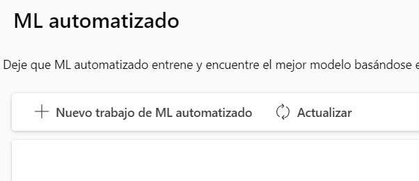

2. Pulsa **Nuevo trabajo de ML automatizado**. Se abre un asistente de 6 pasos:
   1. Método de entrenamiento
   2. Configuración básica
   3. Tipo de tarea y datos
   4. Configuración de tarea
   5. Proceso (el cómputo)
   6. Revisión
3. En **Método de entrenamiento**, elige el entrenamiento automático (*Train automatically*) y continúa.
4. En **Configuración básica**:
   - **Nombre del trabajo:** deja el nombre generado (por ejemplo, `quiet_rat_b1gckd6r40`) o escribe uno propio.
   - **Nombre del experimento:** deja **Crear nuevo** y escribe `practica1-bajas` en *Nombre del experimento nuevo* (por defecto aparece `Default`).
   - **Descripción** y **Etiquetas:** opcionales.
5. Pulsa **Siguiente**.

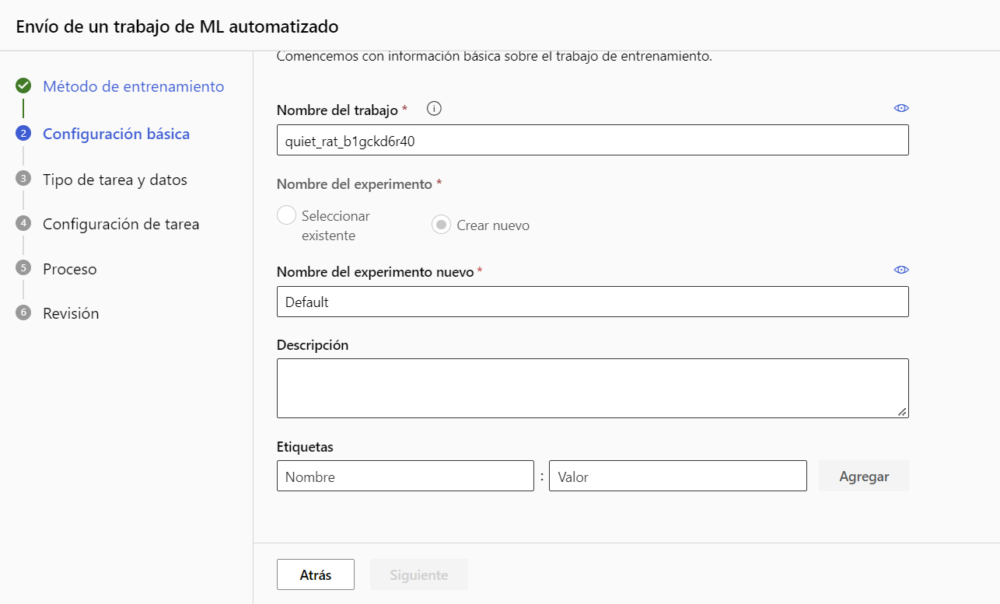

### 3. Subir los datos

1. En **Tipo de tarea y datos**, abre el desplegable **Seleccionar el tipo de tarea**. Verás cinco opciones: Clasificación, Regresión, Previsión de serie temporal, Procesamiento del lenguaje natural y Visión artificial. Elige **Clasificación** ("para predecir una de las distintas categorías: sí/no, azul, rojo, verde").

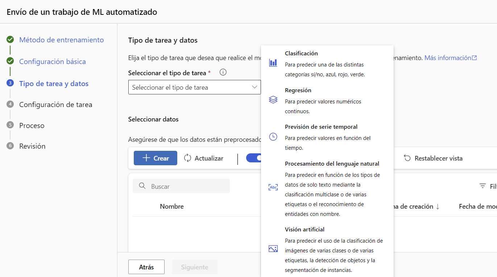
2. En **Seleccionar datos**, pulsa **Crear**. Se abre un asistente para crear el activo de datos. Estos son los pasos, con lo que verás en cada pantalla:

   | Pantalla | Qué hacer |
   |---|---|
   | Tipo de datos | Nombre: `clientes-baja` · Tipo: **Tabular** |
   | Origen de datos | **Desde archivos locales** |
   | Tipo de almacenamiento de destino | Deja el predeterminado (`workspaceblobstore`) |
   | **Elija un archivo o carpeta** | Pulsa **Cargar archivos o carpeta** → elige archivos → `clientes-baja.csv`. Deja sin marcar *Sobrescribir si ya existe*. Los tipos admitidos son delimitados (.csv, .tsv), Parquet, líneas JSON y texto sin formato. |
   | **Configuración** | Formato de archivo: **Delimitado** · Delimitador: **Coma** · Codificación: **UTF-8** · Encabezados de columna: **Todos los archivos tienen los mismos encabezados** · Omisión de filas: **Ninguno**. Deja **sin marcar** *El conjunto de datos contiene datos de varias líneas*. Comprueba que la *Vista previa de datos* muestra las 7 columnas. |
   | **Esquema** | Revisa los tipos detectados (ver más abajo). Deja la columna `Path` **desactivada**, como viene por defecto. |
   | Revisión | **Crear** |

   Pantallas de referencia:

   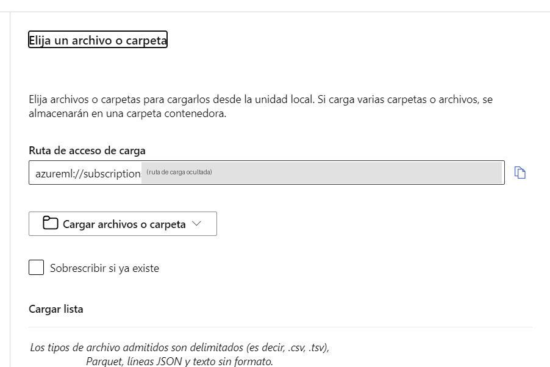

   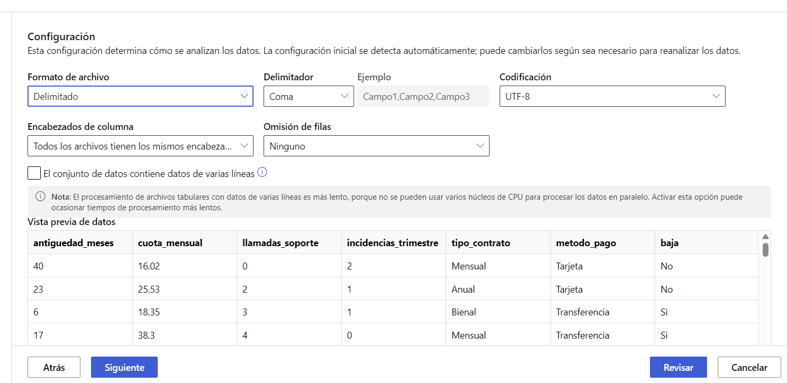

   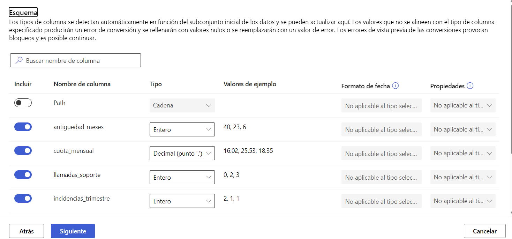

   Tipos que debe detectar en el esquema:

   | Columna | Tipo |
   |---|---|
   | `antiguedad_meses`, `llamadas_soporte`, `incidencias_trimestre` | Entero |
   | `cuota_mensual` | Decimal (punto `.`) |
   | `tipo_contrato`, `metodo_pago`, `baja` | Cadena |

3. Vuelve a **Tipo de tarea y datos**. En la lista aparece `clientes-baja` con tipo **Tabla**. Márcalo (si no aparece, pulsa **Actualizar**) y pulsa **Siguiente**.

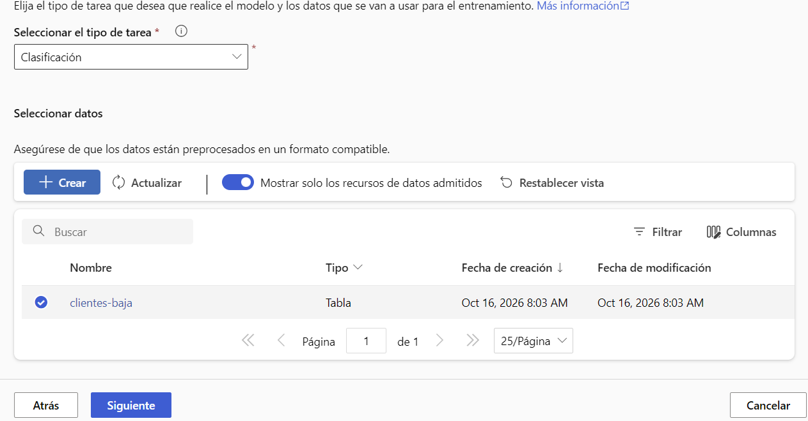

### 4. Configurar la tarea

1. En **Configuración de tarea**, en **Columna de destino** elige **`baja (String)`**.

   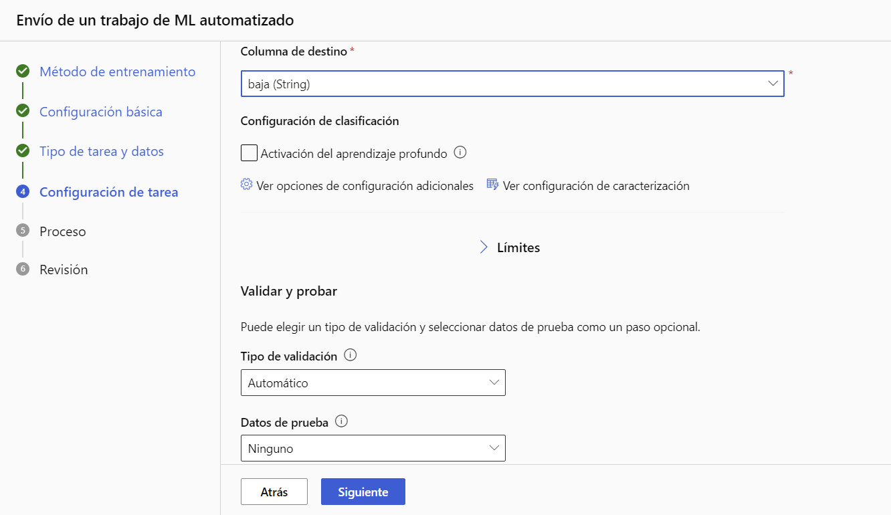
2. En **Configuración de clasificación**, deja **sin marcar** *Activación del aprendizaje profundo*: así el trabajo es más corto y los modelos clásicos se explican mejor.
3. Pulsa **Ver opciones de configuración adicionales** y revisa:
   - **Métrica principal:** la que venga por defecto es válida (en el tutorial se usa `AUCWeighted`).
   - **Explicar el mejor modelo:** actívalo (opcional, útil para el paso 8).
   - **Modelos bloqueados:** ninguno.

   Pulsa **Guardar**.
4. Despliega **Límites** y rellénalo así, para que el trabajo no se alargue en clase:

   | Campo | Valor |
   |---|---|
   | Número máximo de pruebas | `6` |
   | Número máximo de pruebas simultáneas | `1` (no más que el número de instancias del paso *Proceso*) |
   | Número máximo de nodos | Déjalo vacío |
   | Umbral de puntuación de métrica | Déjalo vacío |
   | Tiempo de espera del experimento (minutos) | `30` |
   | Tiempo de espera de iteración (minutos) | `15` |
   | Habilitar finalización anticipada | Marcado |

   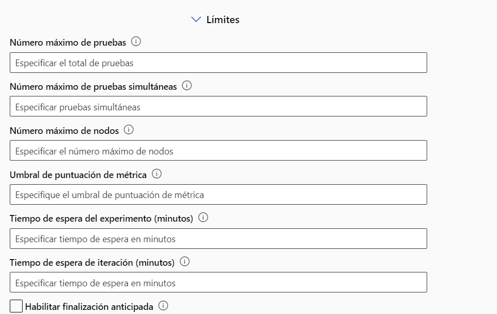

   Los tiempos de espera deben estar entre **15 y 10080 minutos** (1 semana). El del experimento debe ser, como mínimo, igual que el de iteración. Con una sola instancia las pruebas se ejecutan una tras otra. Con estos límites el trabajo se detiene como máximo a los 30 minutos y suele terminar antes, al llegar a las 6 pruebas.
5. En **Validar y probar**, deja **Tipo de validación: Automático** y **Datos de prueba: Ninguno**.
6. Pulsa **Siguiente**.

> Los pasos 1 a 6 están contrastados con la interfaz real en español. El paso 7 está contrastado con la interfaz real. El paso 8 (explicar el modelo) aún no, y sus nombres pueden diferir ligeramente.

### 5. Elegir el cómputo (paso **Proceso**)

En **Seleccionar un tipo de proceso** hay tres opciones: **Clúster de proceso**, **Instancia de proceso** y **Sin servidor**. Para esta práctica usa **Sin servidor**: no tienes que crear nada antes, Azure asigna las máquinas al lanzar el trabajo y las libera al terminar.

Configúralo así:

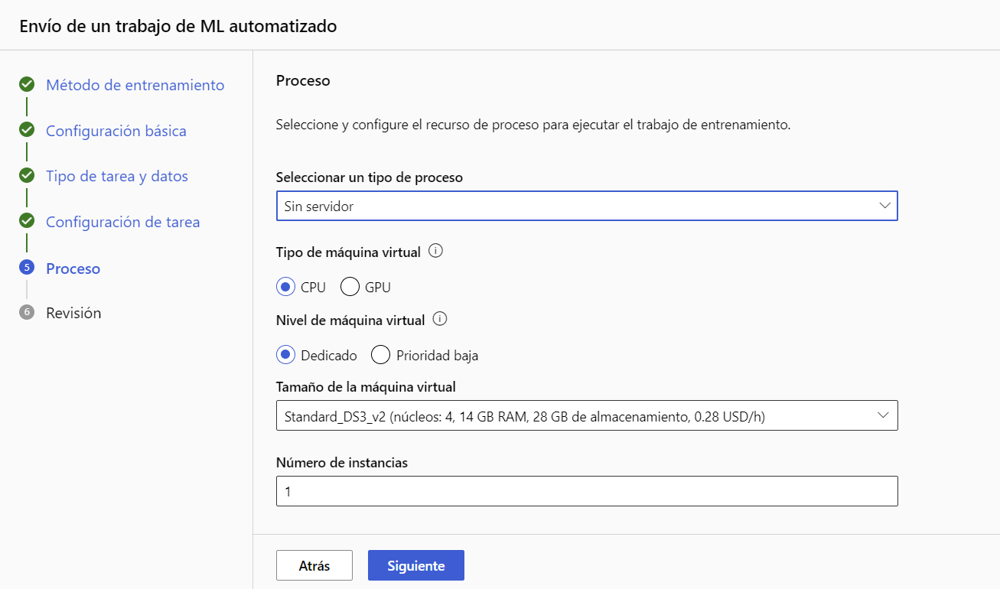

Opciones del desplegable de tipo de proceso:

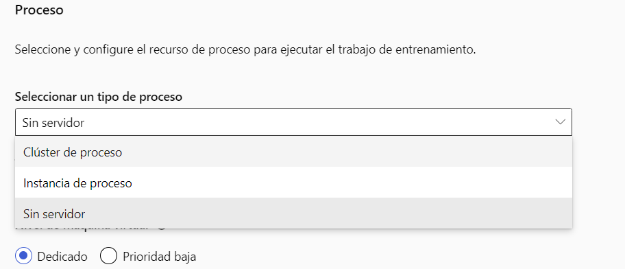

| Campo | Valor |
|---|---|
| Seleccionar un tipo de proceso | **Sin servidor** |
| Tipo de máquina virtual | **CPU** |
| Nivel de máquina virtual | **Dedicado** (*Prioridad baja* es más barato, pero puede interrumpirse) |
| Tamaño de la máquina virtual | `Standard_DS3_v2` (4 núcleos, 14 GB de RAM, 28 GB de almacenamiento; en la pantalla figura a 0,28 USD/h) |
| Número de instancias | `1` (es el valor que permite Studio; encaja con 1 prueba simultánea del paso 4) |

Pulsa **Siguiente**.

> **Cuota:** una instancia de `Standard_DS3_v2` usa 4 núcleos de la familia DSv2. Si el trabajo falla por cuota, prueba otro tamaño de máquina o pide una ampliación.

> **Coste:** el precio que muestra Studio es de 0,28 USD por hora de ejecución. Un trabajo de 30 minutos queda en torno a 0,14 USD, sin contar el almacenamiento.

### 6. Lanzar el trabajo

1. En **Revisión**, comprueba el resumen y pulsa **Enviar trabajo de aprendizaje**.

   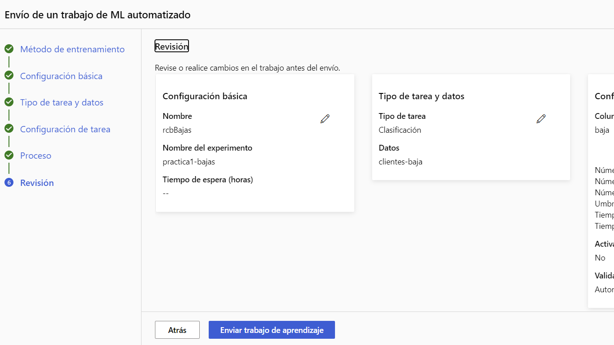
2. Se abre la página del trabajo, con el estado **En ejecución**. Espera:
   - La preparación inicial puede tardar entre 10 y 15 minutos.
   - Después, cada intento tarda unos minutos.
   - En la prueba de referencia, con estos límites y 1 instancia `Standard_DS3_v2`, el trabajo completo duró **16 minutos y 45 segundos**.

   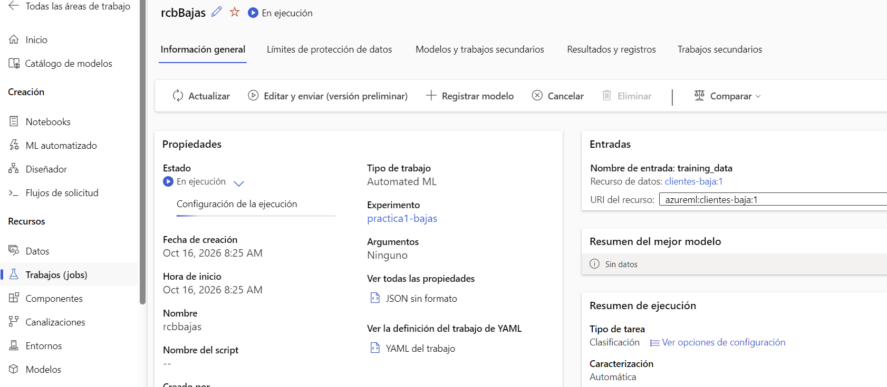

   Si al abrir el trabajo aparece "El trabajo no existe o se ha eliminado" (error 404) mientras la notificación dice que se está ejecutando, espera unos segundos y recarga la página, o ábrelo desde **Trabajos**.

> Mientras espera, ve al paso 9 *Preguntas para la clase*.

### 7. Comparar los modelos

1. Cuando el estado cambie a **Completado**, la página de **Información general** muestra la duración, los datos de entrada, la salida `best_model` (un modelo en formato MLflow) y el **Resumen del mejor modelo**, con el nombre del algoritmo ganador. En la prueba de referencia ganó `VotingEnsemble`.

   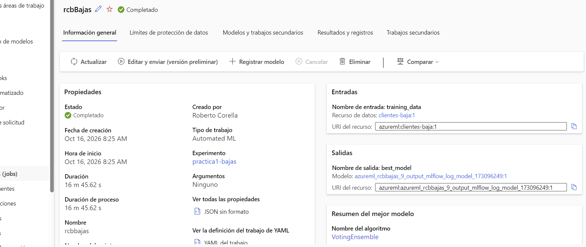

2. Abre la pestaña **Modelos y trabajos secundarios**. La página tiene también *Información general*, *Límites de protección de datos*, *Resultados y registros* y *Trabajos secundarios*.
3. La lista muestra una fila por modelo, con estas columnas: **Nombre del algoritmo**, **IA responsable**, **Valor ponderado** (la métrica principal, ordenada de mayor a menor), **Muestreo**, **Fecha de creación**, **Duración** e **Hiperparámetros**. El mejor modelo está arriba.

   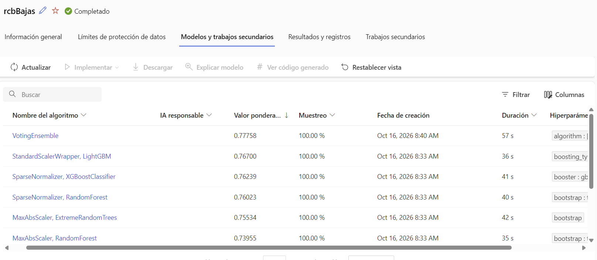

4. Fíjate en que cada fila es un **algoritmo distinto** con su puntuación. Esa comparación es lo que ha automatizado el servicio. En la prueba de referencia:

   | Algoritmo | Valor ponderado |
   |---|---|
   | `VotingEnsemble` | 0,778 |
   | `StandardScalerWrapper, LightGBM` | 0,767 |
   | `SparseNormalizer, XGBoostClassifier` | 0,762 |
   | `SparseNormalizer, RandomForest` | 0,760 |
   | `MaxAbsScaler, ExtremeRandomTrees` | 0,755 |
   | `MaxAbsScaler, RandomForest` | 0,740 |

   Las diferencias entre los primeros son pequeñas. Es un buen momento para comentar que el modelo acierta de forma moderada: los datos son sintéticos y con ruido, y que un modelo mejor no es siempre mucho mejor.
5. La barra de herramientas tiene los botones **Implementar**, **Descargar**, **Explicar modelo** y **Ver código generado**. Aparecen desactivados hasta que abres o seleccionas un modelo.
6. Abre uno de los modelos (por ejemplo, el primero) y revisa su información y sus métricas.

### 8. Entender por qué decide así (opcional)

> Este paso no se probó en la prueba de referencia. Los nombres de la pestaña de explicaciones vienen del tutorial en inglés.

Si activaste la explicación del mejor modelo, o si la lanzas ahora:

1. Abre el mejor modelo.
2. Pulsa **Explicar modelo**, elige el proceso (cómputo) que te proponga Studio y confirma. Tarda unos minutos.
3. Cuando termine, abre la pestaña de explicaciones y revisa la importancia agregada de las variables (en el tutorial en inglés, *Explanations (preview)* y *Aggregate feature importance*).

**Qué debes observar:** las variables que más pesan en la predicción. Los datos se generaron para que influyan el tipo de contrato, la antigüedad, las llamadas a soporte y las incidencias, así que lo normal es que aparezcan entre las primeras.

### 9. Preguntas para la clase

1. ¿Qué diferencia hay entre este modelo y GPT en Foundry? (Este lo hemos entrenado con nuestros datos.)
2. ¿Por qué se comparan varios algoritmos en lugar de elegir uno?
3. ¿Qué pasaría si volviéramos a entrenar con datos de otro año?
4. ¿Qué haría falta para poner este modelo en producción?

---

## Resultado esperado

- Un trabajo de ML automatizado completado, con una lista de modelos comparados por su métrica.
- Un mejor modelo identificado (en la prueba de referencia, `VotingEnsemble` con un valor ponderado de 0,778), con sus métricas y, si lo pediste, sus explicaciones.

## Siguiente paso

En la [práctica 2](../practica-2/README.md) desplegamos el mejor modelo en un endpoint en tiempo real y lo llamamos desde Postman. En la página del modelo, **Modelos registrados** dice *Registro todavía no disponible* hasta que el modelo se registra o se despliega.

## Problemas frecuentes

| Síntoma | Causa probable | Qué hacer |
|---|---|---|
| El trabajo falla al pedir las máquinas | Falta de cuota de CPU en la región | Prueba otro tamaño de máquina o pide una ampliación de cuota |
| El trabajo se queda en *Preparando* | Es el comportamiento normal de la primera ejecución | Espera 10-15 minutos |
| Falla al leer el CSV | Delimitador incorrecto | Comprueba que el delimitador es **Coma** |
| No puedes elegir `baja` como objetivo | La columna se detectó con otro tipo | Revisa el paso *Esquema* |
| Al abrir el trabajo sale "El trabajo no existe o se ha eliminado" | Studio abrió la página antes de que el trabajo se registrara | Espera unos segundos y recarga, o ábrelo desde **Trabajos** |

## Limpieza

Esta práctica no deja ningún endpoint. El cómputo sin servidor se libera solo al terminar el trabajo. Aun así:

- Comprueba en **Proceso** (o *Compute*) que no queda ninguna instancia de proceso encendida.
- Si no vas a seguir con la práctica 2, puedes borrar todo desde el Portal de Azure: abre el grupo de recursos y pulsa **Eliminar grupo de recursos**.

## Referencias

- [Tutorial: Train a classification model with no-code AutoML in Azure Machine Learning studio](https://learn.microsoft.com/en-us/azure/machine-learning/tutorial-first-experiment-automated-ml)
