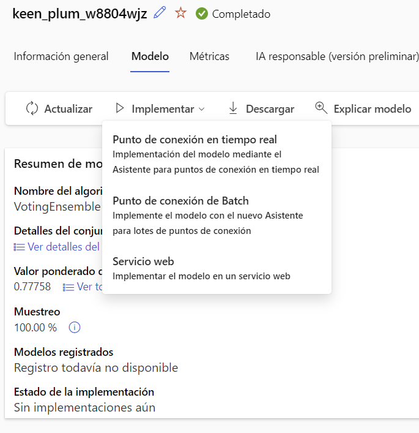
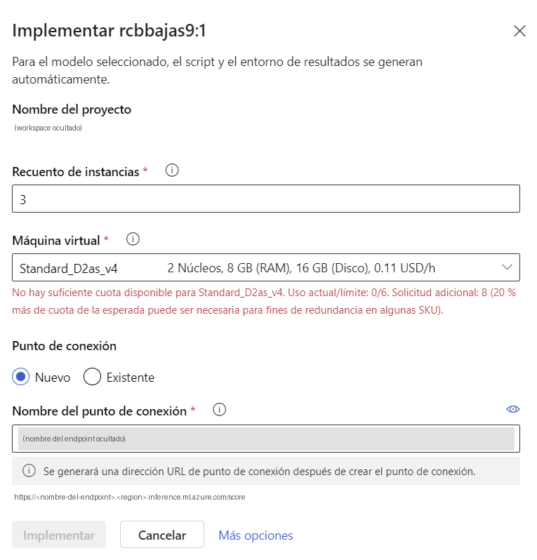

# Práctica 2 · Desplegar el modelo en un endpoint y llamarlo desde Postman

**Duración:** 25 minutos (el despliegue se ejecuta en segundo plano)
**Nivel:** introductorio, sin escribir código
**Qué aprenderás:** el paso de *modelo entrenado* a *servicio que otros pueden llamar*: registrar, desplegar, probar y consumir un endpoint online.

## Escenario

En la práctica 1 entrenamos un modelo que predice si un cliente se dará de baja. Ahora lo ponemos a disposición de otras aplicaciones: le enviamos los datos de un cliente por HTTP y nos devuelve `Si` o `No`.

## Requisitos previos

- La [práctica 1](../practica-1/README.md) terminada, con un **mejor modelo** identificado.
- Cuota de cómputo de CPU para una instancia (el asistente propone `Standard_D2as_v4`, 2 núcleos).
- [Postman](https://www.postman.com/) instalado.
- Los archivos de esta carpeta: `peticion-a-input-data.json` y `peticion-b-data.json`.

> **Estado de esta guía:** los nombres de la ruta de despliegue (modelo → **Implementar** → **Punto de conexión en tiempo real**) están contrastados con la interfaz real. El panel inicial del asistente también. La espera del despliegue y el estado final del endpoint están contrastados. Las pestañas **Prueba** y **Consumir** y la llamada desde Postman **aún no**. Cuando los hagas, completa o corrige este documento.

---

## Paso a paso

### 1. Registrar el modelo (si no lo hiciste ya)

1. Abre el trabajo `rcbBajas` desde **Trabajos**.
2. En la barra de herramientas, pulsa **Registrar modelo** (si no se activa, el siguiente paso también registra el modelo al desplegar).
3. Comprueba en **Modelos** (menú izquierdo) que aparece con su versión.

### 2. Desplegar el mejor modelo

1. En el trabajo, abre la pestaña **Modelos y trabajos secundarios**.
2. Selecciona el mejor modelo (el primero de la lista).
3. Se abre la página del modelo, con las pestañas *Información general*, **Modelo**, *Métricas* e *IA responsable (versión preliminar)*. En el resumen verás que **Modelos registrados** dice *Registro todavía no disponible* y que **Estado de la implementación** dice *Sin implementaciones aún*.
4. Pulsa **Implementar** en la barra de herramientas. El menú ofrece tres opciones:

   | Opción | Para qué sirve |
   |---|---|
   | **Punto de conexión en tiempo real** | Respuesta inmediata a cada petición. **Elige esta.** |
   | Punto de conexión de Batch | Procesar lotes de datos de una vez |
   | Servicio web | Implementar el modelo en un servicio web (la opción del tutorial antiguo) |

   

5. Se abre el panel **Implementar** con el nombre del modelo. Indica que el script y el entorno se generan automáticamente: no hace falta escribir ningún script.

   

6. Ajusta estos valores:

   | Campo | Valor |
   |---|---|
   | **Recuento de instancias** | **`1`**. Por defecto aparece `3`, que es una configuración pensada para producción y consume más cuota. |
   | **Máquina virtual** | Deja la que viene por defecto (`Standard_D2as_v4`: 2 núcleos, 8 GB de RAM, unos 0,11 USD/h según el panel). |
   | **Punto de conexión** | **Nuevo** |
   | **Nombre del punto de conexión** | Studio propone uno. Puedes dejarlo o cambiarlo por otro, único en la región. Formará parte de la URL. |

   Con 3 instancias, el panel puede mostrar un error rojo de cuota insuficiente, por ejemplo: *"No hay suficiente cuota disponible para Standard_D2as_v4. Uso actual/límite: 0/6. Solicitud adicional: 8"*. Significa que la suscripción permite 6 núcleos de esa familia, y 3 instancias de 2 núcleos, más un margen del 20 %, necesitan 8. Con **1 instancia** el error desaparece y el botón **Implementar** se activa.

7. Pulsa **Más opciones** para ver el resto de ajustes, como el tipo de autenticación (elige **clave**, si se ofrece). Después pulsa **Implementar**.
8. Al lanzar el despliegue, la página del modelo muestra un aviso verde: *Correcto: La implementación del modelo se ha desencadenado correctamente*. En ese momento **Modelos registrados** pasa a mostrar el nombre del modelo registrado (por ejemplo, `rcbbajas9:1`). Que el aviso diga "desencadenado" significa que se ha iniciado, no que haya terminado: el estado final se mira en **Endpoints**.

### 3. Esperar al despliegue

1. Ve a **Puntos de conexión** (menú izquierdo) y abre tu endpoint.
2. Mira dos estados, que no son lo mismo:
   - El del **endpoint** (la dirección): pasa a *Correcto* enseguida.
   - El de la **implementación** (la máquina con el modelo), en el panel de la derecha: es el que tarda más.
3. El endpoint está listo cuando la implementación aparece como **Correcto**, con la **asignación de tráfico en directo al 100 %**, y la página muestra las pestañas **Detalles**, **Prueba**, **Consumir**, **Supervisión (vista previa)** y **Registros**.
4. En la prueba de referencia, el despliegue tardó **unos 10 minutos** (de las 9:01 a las 9:11).

En la página verás también el **Tipo de autenticación: Key**, el script de puntuación **generado automáticamente** y el **Tipo de proceso: Administrado**.

> Mientras espera, explica la slide S88 (Prompt Flow y su retirada).

### 4. Probarlo dentro de Studio

1. En la página del endpoint, abre la pestaña **Prueba**.
2. Pega el contenido de `peticion-a-input-data.json` y envíalo. El modelo de salida del trabajo (`best_model`) es de tipo MLflow, y para esos modelos la documentación de Azure ML usa el formato `input_data` con `columns` y `data`.
3. Si da un error de formato, prueba con `peticion-b-data.json`. El formato que acepta depende del script de puntuación que generó Studio. Para saber cuál usar, mira el ejemplo que muestra la pestaña **Consumir**.

### 5. Llamarlo desde Postman

1. En la pestaña **Consumir** del endpoint, copia:
   - La **dirección REST** del endpoint (*REST endpoint*).
   - La **clave principal** (*primary key*).
2. En Postman, crea una petición **POST** a esa dirección.
3. En **Headers**, añade:

   | Cabecera | Valor |
   |---|---|
   | `Content-Type` | `application/json` |
   | `Authorization` | `Bearer <tu clave>` |

4. En **Body**, elige **raw → JSON** y pega el contenido del archivo que funcionó en el paso 4.
5. Pulsa **Send**.

### 6. Interpretar el resultado

Las dos filas de ejemplo están pensadas para que el modelo dé respuestas distintas:

| Cliente | Perfil | Respuesta esperada |
|---|---|---|
| 0 | 3 meses de antigüedad, cuota alta, 5 llamadas a soporte, 3 incidencias, contrato mensual | `Si` (probable baja) |
| 1 | 60 meses, cuota baja, sin llamadas ni incidencias, contrato bienal | `No` (probable permanencia) |

Si el modelo no coincide, no es un fallo de la práctica: es un modelo entrenado con pocos datos sintéticos. Es un buen momento para comentar que un modelo no es una regla fija.

### 7. Preguntas para la clase

1. ¿Qué cambia entre entrenar el modelo y desplegarlo?
2. ¿Quién debería poder llamar a este endpoint? ¿Cómo se protege?
3. ¿Qué pasaría si mañana cambian los datos de los clientes?
4. ¿Cómo sabríamos que el modelo empieza a fallar? (Pista: supervisión con Application Insights.)

---

## Resultado esperado

- Un endpoint online activo con el modelo desplegado.
- Una llamada desde Postman que devuelve una predicción para cada cliente enviado.

## Problemas frecuentes

| Síntoma | Causa probable | Qué hacer |
|---|---|---|
| *Resource provider [N/A] isn't registered with Subscription [N/A]* o *No se pudo crear la implementación* | A la suscripción le faltan proveedores de recursos por registrar | En el Portal de Azure: **Suscripciones** → tu suscripción → **Configuración → Proveedores de recursos**. Registra `Microsoft.PolicyInsights` y `Microsoft.Cdn`, espera a que figuren como **Registrado** y repite el despliegue. Si persiste, revisa los detalles de la implementación en el Portal y registra los que falten. |
| Error rojo de cuota en el asistente | Pides más núcleos de los que permite la suscripción (por defecto, 3 instancias) | Baja a **1 instancia**, prueba otro tamaño de máquina o pide ampliar la cuota |
| El despliegue falla | Falta de cuota de CPU en la región | Prueba otro tamaño de máquina o pide ampliar la cuota |
| El nombre del endpoint no se acepta | Ya existe en la región | Usa un nombre único |
| `401` en Postman | Clave incorrecta o cabecera mal escrita | Copia la clave de la pestaña de consumo y comprueba la cabecera `Authorization` (el formato habitual es `Bearer <clave>`; confírmalo en el ejemplo de la pestaña) |
| Error `4xx` o `5xx` con un mensaje sobre el modelo o las columnas | Formato de la petición distinto del esperado | Prueba el otro archivo JSON |
| Errores de columnas | Nombres o tipos distintos de los del entrenamiento | Usa las mismas 6 columnas que el CSV, sin `baja` |

## Limpieza (importante)

El endpoint **cuesta dinero mientras exista**, aunque no lo uses.

1. Ve a **Endpoints**.
2. Selecciona tu endpoint y pulsa **Eliminar**.
3. Para borrar todo el entorno, elimina el grupo de recursos desde el Portal de Azure.

## Referencias

- [Deploy an AutoML model with an online endpoint](https://learn.microsoft.com/ms-my/azure/machine-learning/how-to-deploy-automl-endpoint?view=azureml-api-2)
- [Deploy MLflow models to online endpoints](https://learn.microsoft.com/en-us/azure/machine-learning/how-to-deploy-mlflow-models-online-endpoints)
